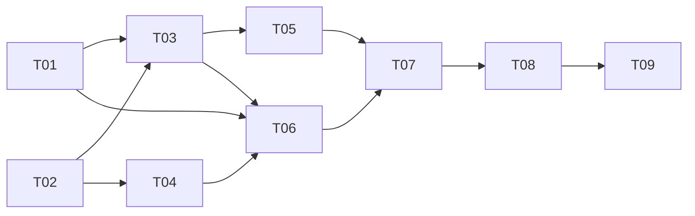

# План реализации MVP

Пользователь разрешил реализацию T01–T09 по зависимостям. T01–T09 выполнены и
приняты; offline MVP прошёл независимую итоговую приёмку. Актуальные статусы
находятся в [машиночитаемом реестре](tasks/index.json), результаты — в
[журнале](docs/execution-log.md).

## Последовательность

1. T01: закрепить протокол и объяснить расхождения источников.
2. T02: создать Python-пакет, settings, валидацию подписки и unit-инструменты.
3. T03: реализовать извлечение метаданных с сохранением исходного JSON.
4. T04: авторизация, обновление токена и классификация ошибок.
5. T05: batch writer, повтор записи и корректный учёт очереди.
6. T06: WebSocket reader, reconnect, повторная подписка и обновление длинной сессии.
7. T07: supervisor, сигналы и ограниченный shutdown, наблюдаемость.
8. T08: Docker/Compose, настоящий ClickHouse в integration, runbook.
9. T09: независимая приёмка и отчёт о готовности, live smoke отдельно.

## Передача работы

T01 и T02 независимы. После T02 авторизация могла выполняться одновременно с parser.
Writer и reader выполнялись независимо после готовности их входных контрактов.
Координатор принимал каждый результат до разблокировки следующей зависимости.

Каждая задача содержит входные документы, список изменяемых файлов, требования,
приёмку и команды. Координатор интегрирует изменения общих файлов. В общей рабочей
директории нельзя одновременно редактировать один файл несколькими агентами.

Выполнение `make prompt TASK=T03` выводит конкретный brief. Агент не должен
реализовывать весь roadmap, получив одну задачу. Рутинные решения внутри выданной
задачи не требуют повторного разрешения. Новые требования отражаются в решениях.

## Готовность и доказательства

`todo` означает запланировано, `in_progress` — есть владелец, `blocked` — указана
конкретная внешняя причина, `done` — записаны фактические проверки и evidence.
Зависимости вычисляются из реестра. Отсутствие доступа к БКС не мешает offline-части T01;
неподтверждённые wire-форматы остаются явными ограничениями до live smoke.

Перед сдачей MVP должны пройти S01–S16 из приёмки. S17 требует live-доступа:
без него возможна сдача offline MVP с отметкой `production readiness: unverified`,
но нельзя объявлять проверенной работу с реальным БКС.
