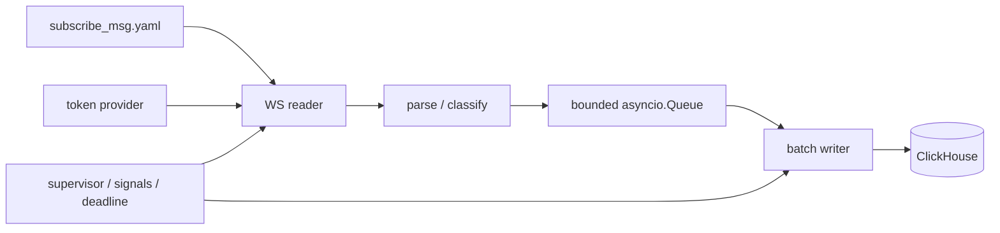

# Архитектура и границы модулей

Один процесс, один reader и один writer. По умолчанию одна WS-сессия на весь список
инструментов. Если реальный лимит подписки БКС окажется меньше 101 инструмента,
зафиксировать ограничение и пересмотреть разбиение соединений; не отбрасывать список молча.



## Планируемые модули

| Файл | Ответственность | Задача |
| --- | --- | --- |
| `app/settings.py` | Env и validation до сети, скрытые секреты | T02 |
| `app/subscribe.py` | Безопасный YAML loader и wire JSON подписки | T02 |
| `app/parser.py` | Чистая классификация frame и immutable row | T03 |
| `app/token_provider.py` | Получение, кэш, expiry и invalidate | T04 |
| `app/ch_writer.py` | Batch, INSERT, retry, подтверждение очереди | T05 |
| `app/ws_reader.py` | Handshake, recv, reconnect/resubscribe | T06 |
| `app/main.py` | Lifecycle, supervisor и exit status | T07 |
| `app/logging_setup.py` | Безопасные логи и summary | T07 |

Settings не импортирует runtime workers. Parser не знает о сети и CH. Writer не
знает о WS. Token provider не владеет reconnect. Main координирует зависимости
явно; DI-контейнер не нужен. Никаких импортов из соседних репозиториев в runtime.

## Общие контракты

T02 закрепляет settings и способ загрузки подписки; T03 предоставляет:

```python
@dataclass(frozen=True)
class TradeRawRow:
    received_at: datetime
    source: str
    ticker: str
    class_code: str
    event_time: datetime
    raw_json: str

def parse_message(
    raw_msg: str | bytes, *, source: str, received_at: datetime
) -> ParseResult:
    ...
```

`ParseResult` содержит `kind`, optional `row` и безопасный `error_code`/reason.
Kinds соответствуют протоколу: trade, control, other, malformed, malformed_trade,
source_error. Только `trade` имеет row. Reader передаёт уже зафиксированный UTC
`received_at`; parser не получает текущее время сам. Для source_error reader
использует структурированный error code, не сканирует raw JSON на подстроки.

T04 предоставляет `AccessTokenProvider.get_token()`, `invalidate()`, чтение срока
годности кэша через безопасный monotonic deadline/TTL; исключения `AuthError`,
`TemporaryAuthError`, `AuthConfigurationError`. Статический режим отличается явно.
Token provider не логирует токены и не управляет остановкой приложения.

T05 предоставляет async writer loop и отдельную функцию/метод INSERT для тестируемого
клиента. Reader помещает `TradeRawRow` в ограниченную очередь. Состояние окончания
producer отличается от запроса остановки: writer не завершает drain до подтверждения
окончания producer. Общий shutdown deadline устанавливает supervisor ровно один раз.
T05 и T06 документируют свои вызовы в task report, T07 интегрирует lifecycle API
без введения универсального framework. Очередь подтверждается после INSERT.

## Что брать из quotes

Изучить settings, token provider, column order, offloaded CH I/O и Compose как
референсы. Не переносить слепо:

- парсер принимает только Quotes и допускает naive time/coercion идентификаторов;
- task_done вызывается до INSERT;
- retry CH и shutdown могут ждать бесконечно;
- cached token обновляется при reconnect, не во время долгой сессии;
- broad exception retry может скрывать ошибку программирования;
- пример локального CH использует `latest` и публикует общие порты.

Эти наблюдения относятся к прочитанным локальным файлам, а не к аудиту сервера.
Новый сервис не должен менять quotes-сервис в рамках данного roadmap.
